<a href="https://saroshaga.github.io">
  
</a>

I lead engineering teams building applied AI for the open web. Nine years, from platform engineering to GenAI, the last four as a manager.

```text
$ git log --oneline --graph

* 4e1c9a0  (HEAD) after hours: interactive maps of Dubai, forecasting next
* 3d4a6b1  mandate: applied ML and GenAI · agentic framework, AI site builder at ~2,000 DAU
* 8f27c3d  genai: image generation and editing at 1,000+ DAU, post-to-video in about a minute
* c51e08a  experiments: Thompson Sampling headline testing · +120% ARR in four months
* 9b2d7f3  mandate: data and analytics · warehouse, pipelines, anomaly detection
* 1c8e4b2  engineering manager · squads of up to nine, strategy, hiring, documentation standards
* e7a0d15  hosting platform · enterprise → consumer · Kubernetes, support pipelines
* 0a6f2e4  platform engineering, ad tech · master data, ETL, distributed caching
```

**Four threads.** Role: engineer → senior → manager. Mandate: platform → data and analytics → applied ML and GenAI. Domain: ad tech → hosting → analytics → content generation. Industry: enterprise → consumer.

**Writing.** [Lessons learned in two years of working async](https://saroshaga.wordpress.com/2022/09/21/lessons-learned-in-two-years-of-working-async/) · [LeadDev New York 2024](https://saroshaga.wordpress.com/2024/09/16/leaddev-new-york-2024/) · [Build.](https://saroshaga.wordpress.com/2020/07/10/build/)

**[View the full site →](https://saroshaga.github.io)** · [LinkedIn](https://www.linkedin.com/in/sarosh-aga/) · [saroshaga@gmail.com](mailto:saroshaga@gmail.com)
