<a href="https://saroshaga.github.io">
  <picture>
    <source media="(prefers-color-scheme: dark)" srcset="banner-dark.svg">
    
  </picture>
</a>

<a href="https://saroshaga.github.io">
  <picture>
    <source media="(prefers-color-scheme: dark)" srcset="log-dark.svg">
    
  </picture>
</a>

  <a href="https://saroshaga.github.io"><b>View the full site →</b></a> &nbsp;·&nbsp;
  <a href="https://www.linkedin.com/in/sarosh-aga/">LinkedIn</a> &nbsp;·&nbsp;
  <a href="https://saroshaga.wordpress.com">Writing</a> &nbsp;·&nbsp;
  <a href="mailto:saroshaga@gmail.com">saroshaga@gmail.com</a>

